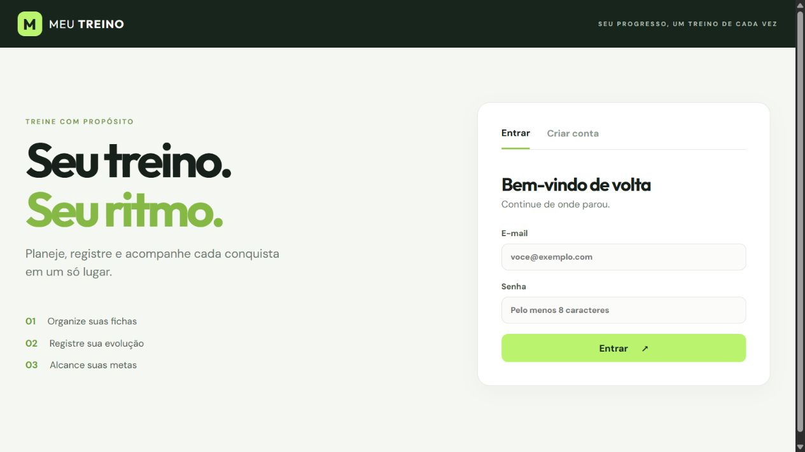
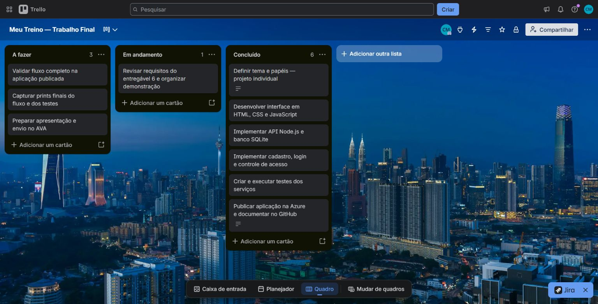
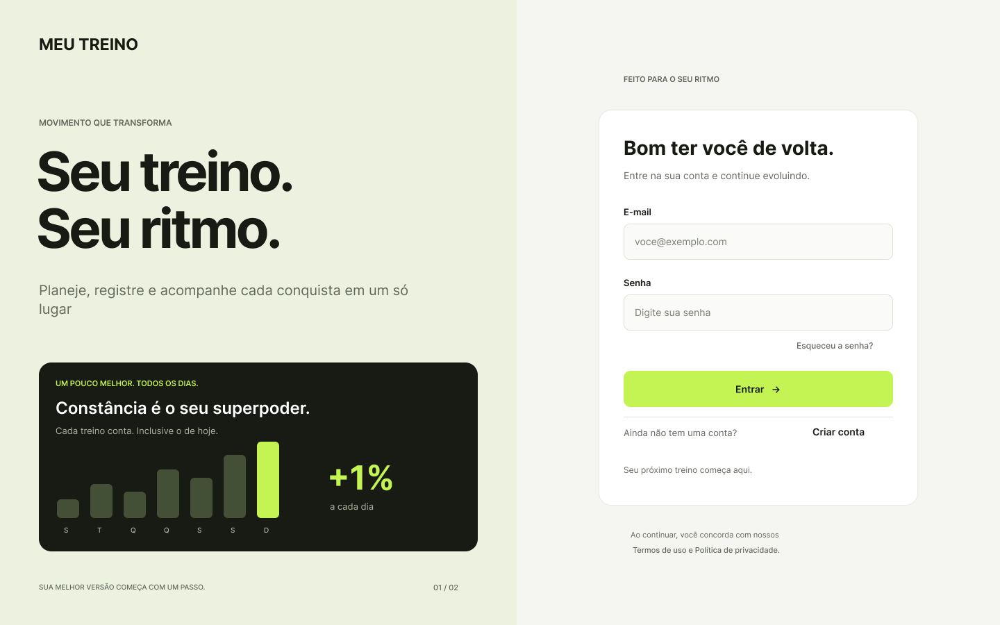
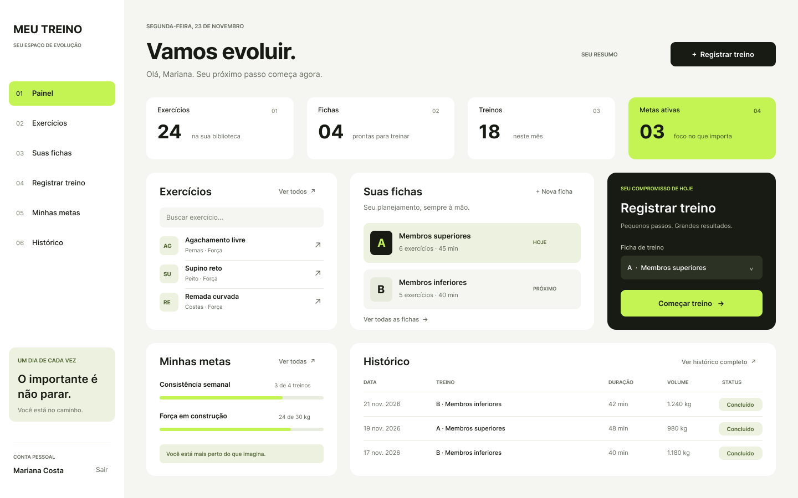
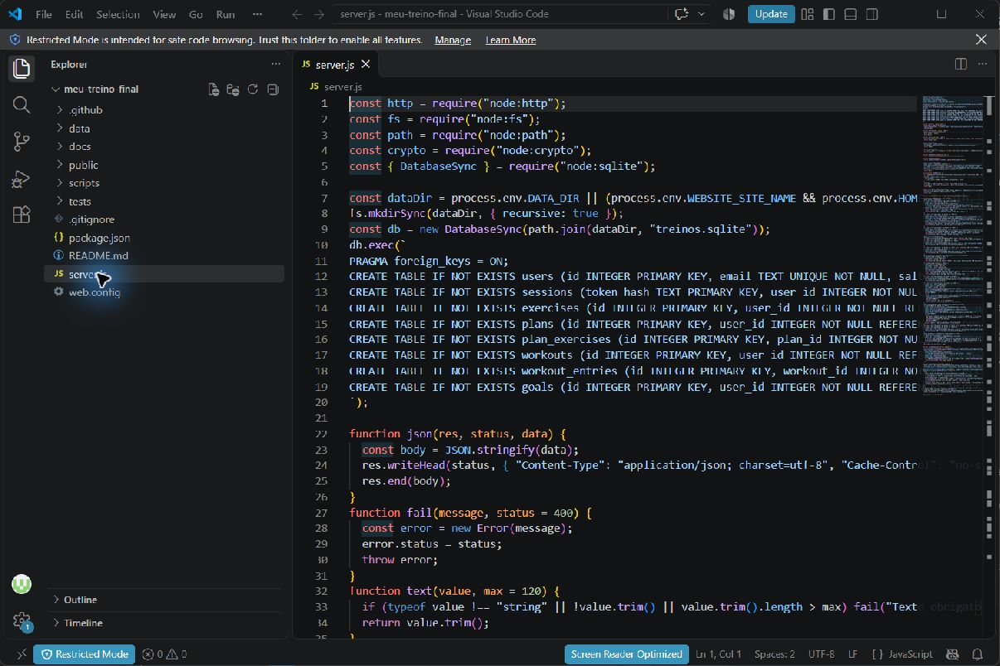
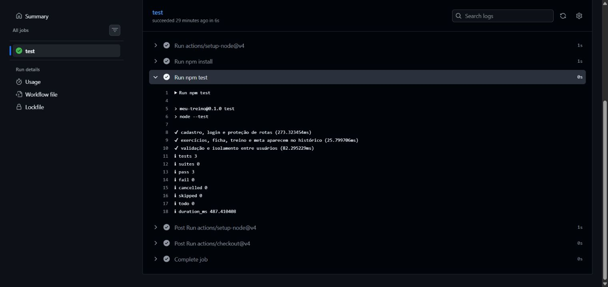
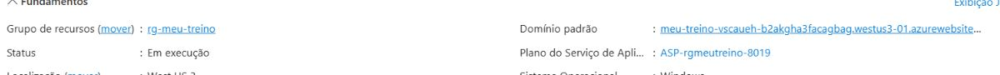
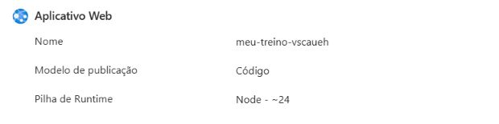

# Meu Treino

Aplicação web individual para organizar fichas, registrar treinos e acompanhar metas. Desenvolvida para os entregáveis 5 e final da disciplina de Ambientes de Desenvolvimento de Software.

**Aplicação publicada na Microsoft Azure:** [Abrir Meu Treino](https://meu-treino-vscaueh-b2akgha3facagbag.westus3-01.azurewebsites.net/)

## Tecnologias e serviços usados

| Parte | Tecnologia ou serviço | Uso no projeto |
| --- | --- | --- |
| Interface | HTML, CSS e JavaScript | Páginas, formulários, painel e comunicação com a API usando `fetch` |
| Servidor | Node.js 24, módulo `node:http` | Servir a interface e disponibilizar as rotas da API |
| Banco de dados | SQLite, módulo `node:sqlite` | Guardar usuários, sessões, exercícios, fichas, treinos e metas |
| Autenticação | `node:crypto` e cookies HTTP-only | Gerar hash das senhas, criar sessões e proteger os dados de cada usuário |
| Testes | `node:test` e `node:assert` | Verificar os principais fluxos da API com `npm test` |
| Código-fonte | GitHub | Versionar e disponibilizar o projeto |
| Nuvem | Microsoft Azure App Service | Executar a aplicação e oferecer a URL pública |
| Configuração da hospedagem | `web.config` e IISNode | Iniciar e encaminhar as requisições para o servidor Node.js no App Service para Windows |

O projeto não depende de bibliotecas externas do npm. O banco SQLite é criado automaticamente na primeira execução.

## Funcionalidades

1. Criar uma conta, entrar e sair.
2. Cadastrar exercícios com grupo muscular.
3. Criar fichas e adicionar exercícios a elas.
4. Registrar e editar treinos com data, séries, repetições, carga e observações.
5. Consultar o histórico de treinos.
6. Criar e concluir metas.
7. Ver no painel as quantidades de exercícios, fichas, treinos e metas ativas.

O navegador envia requisições à API do Node.js. O servidor valida os dados, identifica o usuário pela sessão e lê ou grava os registros no SQLite. Cada usuário acessa somente seus próprios dados. As consultas usam parâmetros e as senhas não são salvas em texto puro.

## Executar no computador

Requer **Node.js 24 ou superior**. Na pasta do projeto:

```bash
npm install
npm start
```

Abra <http://localhost:3000>. O arquivo local do banco fica em `data/treinos.sqlite` e não é enviado ao GitHub.

## Executar os testes

```bash
npm test
```

Em 23/11/2026, os **3 testes passaram** localmente. Eles verificam cadastro e login, proteção das rotas, criação de exercícios, fichas, treinos e metas, edição de treino, validação de entradas e separação dos dados entre usuários. Os cenários estão em [`tests/app.test.js`](tests/app.test.js). O GitHub Actions também executa os testes a cada envio de código.

## Inspecionar o banco de dados

Depois de iniciar a aplicação uma vez, execute:

```bash
npm run db:inspect
```

O comando usa o cliente SQLite do Node.js para listar as oito tabelas do banco local. Ele abre o arquivo somente para leitura e não mostra e-mails, senhas ou registros de usuários. O script está em [`scripts/inspect-db.js`](scripts/inspect-db.js). Para consultar outro diretório, defina `DATA_DIR` antes de executar o comando.

## Publicação na Azure

A aplicação está em um **Web App do Azure App Service para Windows**, com Node.js 24. O arquivo [`web.config`](web.config) encaminha as requisições ao [`server.js`](server.js). A aplicação usa a porta fornecida pelo ambiente em `PORT`.

No App Service, o SQLite é armazenado em `%HOME%/site/wwwroot/App_Data/meu-treino`. Localmente, usa a pasta `data`. A variável `DATA_DIR` permite indicar outro diretório. O conteúdo do banco não está no repositório; antes de uma nova publicação, é importante manter uma cópia dos dados.

Tutorial de referência para a implantação: [Criar um aplicativo Web Node.js no Azure App Service](https://learn.microsoft.com/pt-br/azure/app-service/quickstart-nodejs). Consulte também a [documentação do Node.js no App Service](https://learn.microsoft.com/pt-br/azure/app-service/configure-language-nodejs).

## Arquivos principais

```text
public/          Interface web (HTML, CSS e JavaScript)
server.js        Servidor, API e acesso ao SQLite
tests/           Testes automatizados
web.config       Configuração da aplicação no Azure App Service
docs/evidencias/ Prints da aplicação publicada
scripts/         Consulta da estrutura do banco SQLite
```

## Trabalho final: seis ambientes

Projeto individual: Caueh Motta é responsável pelo planejamento, design, implementação, testes e publicação.

| Ambiente solicitado | Como foi usado |
| --- | --- |
| Gestão de tarefas | Quadro Trello **Meu Treino — Trabalho Final**, com listas A fazer, Em andamento e Concluído. O quadro é privado; o print abaixo registra as tarefas e os papéis. |
| Design de interfaces | [Protótipo no Figma](https://www.figma.com/design/Cx5uPXwOuBWwmiUsfv5mBH/Meu-Treino-%E2%80%94-prot%C3%B3tipo-de-interface), com telas editáveis de login e painel. É uma proposta visual; alguns dados e detalhes ilustrativos diferem da aplicação funcional. |
| Desenvolvimento | Visual Studio Code para trabalhar nos arquivos da interface, do servidor Node.js e dos testes, com versão do código neste repositório. |
| Banco de dados | SQLite acessado pelo módulo `node:sqlite`. O comando `npm run db:inspect` permite conferir a estrutura do banco sem expor dados pessoais. |
| Testes | `node:test` e `node:assert` com `npm test`, executados localmente e no GitHub Actions. Selenium foi citado como exemplo na atividade; aqui o ambiente de testes usado foi o Node.js com CI. |
| Execução e servidor web | Node.js no Microsoft Azure App Service. A [URL pública](https://meu-treino-vscaueh-b2akgha3facagbag.westus3-01.azurewebsites.net/) permite testar a aplicação no navegador. |

Fluxo da aplicação: **navegador → API Node.js → SQLite → resposta ao navegador**. O servidor valida as entradas e relaciona cada registro ao usuário autenticado.

## Evidências

Capturas da aplicação publicada na Azure em **19/11/2026**:

**Tela de entrada:** a URL pública abre a interface de cadastro e login.



**Painel após o login:** recorte com os indicadores, exercícios e fichas da conta de demonstração.


### Evidências do trabalho final

**Gestão de tarefas no Trello:**



**Protótipo de interface no Figma:**





**Desenvolvimento no Visual Studio Code e estrutura do SQLite:**



**Testes automatizados no GitHub Actions:**



**Aplicação em execução no Microsoft Azure App Service:**




